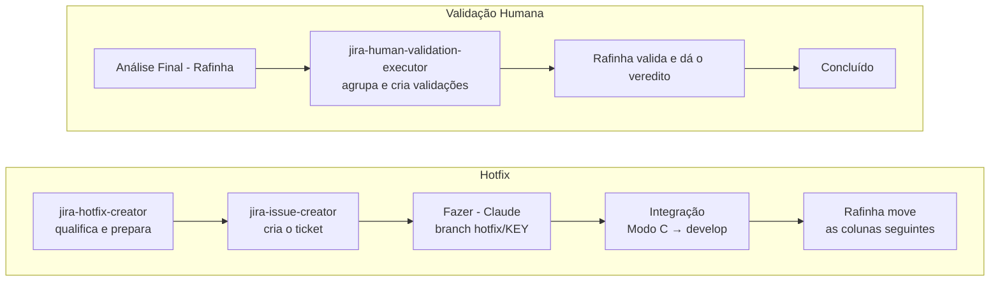
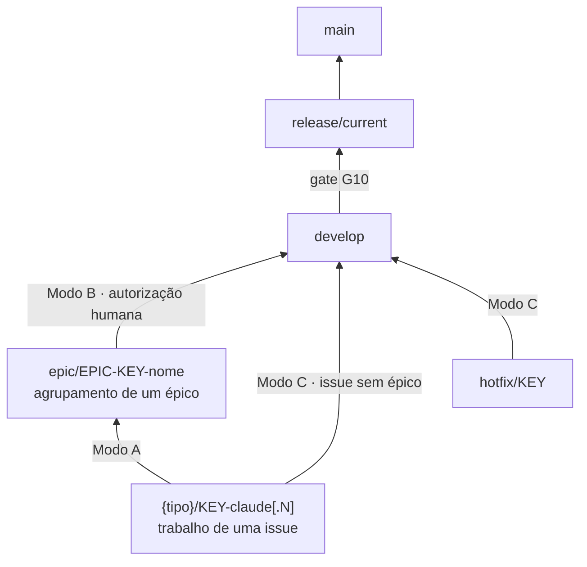
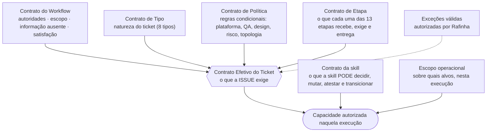

<div align="center">

# Rafinha-Claude

**Engenharia de software orquestrada por IA, com o humano no controle das decisões.**

Um sistema pessoal de orquestração do ciclo de desenvolvimento — da issue no Jira ao release —
em que o Claude Code executa o trabalho operacional dentro de contratos, gates e evidências,
e o desenvolvedor decide o que importa.

</div>

> [!NOTE]
> Este repositório (`skills-claude`) é a implementação do Rafinha-Claude como [skills do Claude Code](https://code.claude.com/docs/en/skills). O nome técnico do repositório não muda; **Rafinha-Claude** é o nome do sistema. Um workflow construído para o ambiente pessoal de Rafinha — leia [Como utilizar](#como-utilizar) antes de reaproveitá-lo.

**Navegação:** [O que é](#o-que-é) · [Origem e evolução](#origem-e-evolução) · [Filosofia](#filosofia) · [Como funciona](#como-funciona) · [Contratos](#arquitetura-de-contratos) · [Capacidades](#capacidades) · [Ecossistema](#ecossistema-tecnológico) · [Catálogo de skills](#catálogo-de-skills) · [Como utilizar](#como-utilizar) · [Estado atual e limites](#estado-atual-e-limites) · [Referências](#referências)

---

## O que é

O Rafinha-Claude trata a IA não como um gerador de código isolado, mas como **participante de um processo de engenharia**: requisitos registrados, decisões tomadas por quem tem autoridade, contratos que dizem o que cada capacidade pode fazer, gates que bloqueiam o avanço sem evidência, e rastros que permitem auditar tudo depois.

Na prática, o board do Jira é o mapa do processo e cada etapa tem uma skill dona:

- **O Claude Code executa o trabalho operacional**: maturar issues, preparar o ambiente técnico e as branches, implementar com testes e abrir o Pull Request, integrar, rodar QA, escrever a documentação, auditar o resultado e preparar releases.
- **O desenvolvedor mantém as decisões que não são da IA**: regras de negócio, design de produto, decisões técnicas não determinísticas, revisão de código, aceitação do produto, o modo de cada integração e o incremento de cada versão.
- **Os contratos ligam os dois lados**: uma skill só age dentro da autoridade que o seu contrato declara, sobre um escopo que o humano confirmou, e deixa evidência verificável do que fez.

A autonomia da IA aqui é **operacional e supervisionada** — não é um agente que percorre todas as etapas por conta própria.

### Quem faz o quê

| Responsabilidade | Rafinha | Claude (via skills) |
|---|---|---|
| Regras de negócio e escopo | Decide (`Decisão - Rafinha`) | Levanta pendências, conduz a conversa, registra a decisão |
| Design de produto | Constrói e aprova (`Design de produto - Rafinha`) | Consome o Design Package; bloqueia se ele não existe |
| Decisão técnica não determinística | Decide, perguntado durante a Preparação técnica | Classifica o achado e pergunta |
| Preparação técnica, implementação, integração, QA, documentação | Define o escopo; autoriza `Ready → Fazer - Claude` | Executa, com testes e evidências |
| Revisão de código e aceitação do produto | Decide (`Análise - Rafinha`, `Análise Final - Rafinha`) | Prepara o material (PR, evidências, Validações Humanas) |
| Modo e merge de integração; incremento de versão | Decide e autoriza | Sugere, valida, executa o que foi autorizado |
| Auditoria final | Lê o resultado | Audita contrato, labels, gates e rastros (`Análise Final - Claude`) |

---

## Origem e evolução

O Rafinha-Claude não nasceu como arquitetura. Começou como automação de colunas do Jira e foi ganhando estrutura à medida que cada lacuna operacional aparecia. A história abaixo é reconstruída a partir do histórico Git do repositório, dos registros de implementação (`plano-*.md`) e das mensagens de commit; as datas são as dos commits. O que existiu antes do primeiro commit não está registrado aqui.

### 1. Skills por coluna (agosto de 2026)

O repositório nasce em **11/08/2026** já com skills que automatizam colunas do board: criar e executar issues, fazer QA, documentar e fazer uma segunda revisão. Junto vêm os escritores de documentação para o Confluence e o checklist de padrões Flutter. Cada skill resolvia a sua coluna; o encadeamento entre elas ainda era implícito.

Em **15/08** surge a skill mãe, `workflow-development-flow`: o vocabulário comum do processo (hierarquia Épico → Issue → Subtask, etapas, gates, camadas de validação) e a ligação **GitHub Issue ↔ Jira ↔ Pull Request**. Nasce também a etapa de **Integração**, com merge real validado por GitHub Actions. O fluxo tinha oito etapas.

### 2. Qualidade, controle e continuidade (agosto – setembro)

Com o pipeline rodando, as lacunas passaram a ser de confiança e de continuidade:

- **QA multiplataforma** (22/08): Web pelo Chrome real e Android por Maestro sobre um emulador, com evidências no AIO Tests; o executor passou a rodar code review automatizado sobre o diff antes do PR.
- **Model Escalation Policy** (23/08): o Claude recomenda subir modelo ou esforço quando a complexidade pede, mas nunca troca por conta própria.
- **Validação Humana Agregada** (27/08): a aceitação passou a poder agregar várias issues que alteram o mesmo comportamento, sem repetir o que o QA já automatizou.
- **Execution State** (30/08): uma execução interrompida pode ser retomada por uma sessão nova, reconciliando o arquivo local com Jira, Git e GitHub — o chat deixou de ser fonte de verdade.

### 3. Release como distribuição (agosto – setembro)

O ciclo de release entra em **16/08** como um fluxo separado do board. Em **11–12/09** ele é redesenhado: a unidade versionada passa a ser o **componente** (tags `<componente>/vX.Y.Z`), a topologia do projeto é declarada em manifesto e nada é inferido, e o resultado deixa de ser uma tag com artefato anexado para ser uma **distribuição** que roda fora do ambiente de desenvolvimento, montada por um Release Orchestrator local. Quinze decisões de arquitetura ficaram registradas em [`plano-release-lifecycle.md`](plano-release-lifecycle.md).

### 4. Contratos, gates e design (setembro)

A partir de **20/09** o trabalho passa a ser em *pacotes* de revisão, cada um partindo de uma definição escrita por Rafinha e implementada nas skills e no Confluence:

| Pacote | Problema | Resultado |
|---|---|---|
| **Design, labels e gates** (20/09) | Natureza da issue num campo customizado do Jira; QA assumindo `web` quando faltava a label de plataforma; design sem ponto de entrada no fluxo | Tipo nativo do ticket; matriz oficial de labels; gate de design com `requires-design`; **proibição de fallback silencioso** |
| **Branches por épico e release controlada** (22/09) | Épico sem branch de agrupamento e issues integradas direto na `develop`; sem prova de que a `develop` só carregava trabalho aprovado | Três modos de integração (A/B/C); labels de estado; `release/current` e o gate de elegibilidade G10 |
| **Skills de documentação** (23–26/09) | Documentação tratada como trabalho de um writer só | Cinco writers por fonte da verdade; `jira-doc-executor` passa a orquestrar um *conjunto* de writers por issue |
| **Revisão do workflow inteiro** (26/09) | Execução por varredura de coluna, sem escopo explícito; decisão de produto sem etapa própria no board | Escopo operacional explícito ("nunca coluna inteira"); colunas `Decisão - Rafinha` e `Ready`; descrição padronizada da issue; skills de intake, resolução de decisão e captura de incidentes |
| **Correções de integração e branches** (27/09) | Dois incidentes reais na Integração (escopo restrito à issue em checkout; bloqueio por "ausência de PR" quando a responsabilidade de criá-lo havia mudado) | Integração por Epic; branches como artefatos temporários; PR de promoção próprio com autorização humana distinta |

### 5. Arquitetura de contratos (outubro de 2026)

A revisão mais recente, de **12/10/2026**, consolida o que os pacotes anteriores vinham construindo: o workflow passa a ser governado por **camadas contratuais** (Workflow, Tipo, Política, Etapa → Contrato Efetivo) em vez de regras espalhadas pelas skills. Com ela entram a etapa **Preparação técnica** (o fluxo vai a 13 etapas), o tipo **Hotfix**, as camadas `context/` e `ai-memory/`, o **Workspace** para produtos multi-repositório e quatro skills novas. Não há convivência com o contrato anterior nem migração de issues existentes: o workflow novo é a única referência para novas execuções.

---

## Filosofia

Os princípios abaixo estão presentes nos contratos vigentes e explicam as escolhas de arquitetura.

**Autonomia operacional com supervisão humana.** A IA implementa; não decide requisitos nem regras de negócio que ninguém especificou. A responsabilidade final por regras, aceitação e decisões técnicas críticas é do desenvolvedor. Sem essa fronteira, a velocidade da IA vira decisão de produto tomada por omissão.

**Responsabilidades explícitas.** Cada etapa responde a uma pergunta própria e não assume a de outra. Acesso técnico (um token, uma ferramenta) não é autoridade: o que uma skill pode decidir, alterar, atestar ou transicionar vem do seu contrato, e silêncio não concede poder.

**Execução condicionada por contratos.** Uma skill resolve o contrato aplicável à issue antes de agir. O que a issue exige e o que a skill está autorizada a fazer são coisas diferentes, e a execução acontece sobre um *escopo* confirmado.

**Escopo explícito.** Toda execução operacional começa com um escopo fechado: uma issue, uma lista, um Epic ou a coluna de um Epic específico. **Não existe "coluna inteira".** Estar na coluna certa não basta; estar no escopo também não, se o estado for incompatível.

**Gates verificáveis.** Uma etapa só termina quando a saída esperada está comprovada, e um gate que "deixa passar com aviso" não é gate. Falha de teste, de análise estática ou de pipeline é bloqueio de avanço, não diagnóstico.

**Separação entre implementação e validação.** Quem implementa não atesta. Validação local, GitHub Actions, QA, aceitação humana e auditoria final são camadas distintas, cada uma respondendo a uma pergunta diferente, e nenhuma substitui a outra. Evidência de uma fonte não vale como atestação de outra (um build verde não prova QA nem aceite).

**Rastreabilidade.** Toda decisão relevante deixa registro onde possa ser consultada: comentários estruturados no Jira, Pull Requests, commits. O histórico permanente é *commit + Pull Request + Jira* — não a branch, que é artefato temporário.

**Contexto técnico durável.** O porquê que o código não mostra (restrições, decisões, armadilhas) vive em `context/`, separado do que é só continuidade operacional (`ai-memory/`) e do ponto de retomada de uma única execução (Execution State). Três camadas, três finalidades.

**Continuidade operacional.** O chat é contexto temporário. Uma execução interrompida é retomada por outra sessão a partir das fontes oficiais, reconciliadas antes de qualquer ação — nunca por instrução cega.

**Integração e distribuição controladas.** O modo de integração é informado por Rafinha, o merge de promoção de épico exige autorização humana própria, e a release só parte de uma branch de estabilização cujo conteúdo rastreia para trabalho com QA elegível.

**Sem fallback silencioso.** Quando o contrato esperado não é encontrado, a skill **para e reporta**. Ela não adivinha, não assume o valor mais comum e não volta a ler um contrato antigo. O caso que motivou a regra: o QA assumia `web` quando faltava a label de plataforma — e um QA no executor errado produz um verde que não significa nada.

---

## Como funciona

### O pipeline de 13 etapas

O fluxo normal de uma issue no Jira. Etapas em **azul** são executadas por skills; em **âmbar**, dependem de decisão, revisão ou autorização de Rafinha; em **verde**, o estado final.

```mermaid
flowchart LR
    A1["A fazer"] -->|"intake"| A2["Decisão - Rafinha"]
    A1 -->|"requires-design"| A3["Design de produto - Rafinha"]
    A1 --> A4["Preparação técnica - Claude"]
    A2 --> A3
    A2 --> A4
    A3 --> A4
    A4 -->|"atestado PRONTA"| A5["Ready"]
    A5 -->|"Rafinha autoriza"| B1["Fazer - Claude"]
    B1 --> B2["Análise - Rafinha"]
    B2 --> B3["Integração"]
    B3 --> B4["QA - Claude"]
    B4 --> C1["Análise Final - Rafinha"]
    C1 --> C2["Documentar"]
    C2 --> C3["Análise Final - Claude"]
    C3 --> C4["Concluído"]

    classDef claude fill:#dbeafe,stroke:#1d4ed8,color:#1e3a8a;
    classDef humano fill:#fef3c7,stroke:#b45309,color:#78350f;
    classDef fim fill:#dcfce7,stroke:#15803d,color:#14532d;
    class A4,B1,B4,C2,C3 claude;
    class A2,A3,A5,B2,C1 humano;
    class A1,B3 claude;
    class C4 fim;
```



`A fazer` e `Integração` são as etapas em que skill e humano se encontram: o intake roda sobre um escopo que Rafinha confirmou, e a Integração roda no modo que Rafinha informou. `Ready` é um estado de espera — a passagem para `Fazer - Claude` é a autorização humana de implementação.

### Caminhos excepcionais

Hotfix e Validação Humana não percorrem o fluxo principal. Mantê-los separados evita que o diagrama principal esconda a regra normal.



- **Hotfix**: trabalho emergencial que não pode esperar a preparação normal. Nasce direto em `Fazer - Claude`, com o *fast-track* escrito na descrição (cada obrigação dispensada é `Não aplicável` ou `Excepcionada`, nunca apagada). A branch nasce e volta para `develop`, a integração é sempre Modo C, e **nenhuma skill move uma Hotfix entre colunas** — só Rafinha.
- **Validação Humana**: uma issue própria que agrega, por comportamento funcional, os cenários que ainda exigem julgamento humano. Vai direto a `Concluído`, sem passar por `Documentar` nem por `Análise Final - Claude`.

### Como uma demanda percorre o sistema

1. **Registro.** A necessidade vira uma issue (ou subtask) pela `jira-issue-creator`, com tipo oficial, labels da matriz e a descrição padronizada de nove seções. Uma GitHub Issue também pode ser a origem.
2. **Maturação.** A `jira-sprint-intake-executor` explicita lacunas e roteia a issue: para `Decisão - Rafinha` se há pendência real, para `Design de produto - Rafinha` se `requires-design` foi confirmada, ou direto para a Preparação técnica. Decisões são fechadas uma issue por vez, em conversa, pela `jira-issue-decision-resolver`.
3. **Design.** Quando exigido, Rafinha constrói o design no Claude Design e salva o Design Package localmente.
4. **Preparação técnica.** A `jira-technical-preparation-executor` verifica dependências, design, ambiente e topologia Git, **cria a branch de Epic** quando necessário e emite um atestado (`PRONTA`, `BLOQUEADA` ou `AGUARDANDO DECISÃO TÉCNICA`). Só `PRONTA` leva a `Ready`.
5. **Implementação.** Depois da autorização de Rafinha, a `jira-issue-executor` implementa, testa, roda análise estática e code review automatizado, e abre o Pull Request contra a branch correta.
6. **Revisão e integração.** Rafinha revisa o código. A `jira-integration-executor` valida Actions e conflitos e faz o merge no modo informado, com smoke test.
7. **QA.** A `jira-qa-executor` testa a `develop` integrada no executor da plataforma da issue e registra o veredito.
8. **Aceitação, documentação e auditoria.** Rafinha aceita o produto; os writers registram o estado **aceito**; a `jira-review-executor` faz a auditoria final antes de `Concluído`.
9. **Release.** Fora do board, quando Rafinha pede, a `jira-release-executor` transforma o conjunto de issues concluídas numa distribuição versionada.

### Branches

As colunas dizem em que etapa a issue está; as branches dizem onde o código dela vive. A branch é artefato temporário: depois de cumprir o papel é excluída, e o histórico permanece em commits e Pull Requests.



Os três modos de integração nunca são inferidos: Rafinha informa o modo, com uma única exceção — o tipo Hotfix determina o Modo C.

---

## Arquitetura de contratos

As regras do workflow não vivem soltas dentro de cada skill. Vivem em camadas, e cada skill as consome.



- **Contrato do Workflow** define as regras universais: quem tem autoridade de decisão, mutação, atestação, transição e exceção; como o escopo é fechado; o que fazer quando falta informação; e os seis estados de satisfação de uma obrigação (`Pendente`, `Satisfeita`, `Não satisfeita`, `Não aplicável`, `Não verificável`, `Excepcionada`). `Excepcionada` nunca vira `Satisfeita` em silêncio.
- **Tipo**, **Política** e **Etapa** acrescentam obrigações pela natureza do ticket, por condições verificáveis (uma label com efeito contratual, a topologia do produto) e pela coluna atual.
- O **Contrato Efetivo** é a composição dessas camadas para uma issue. Não é um arquivo nem um campo do Jira: é um procedimento — o *Passo 0* — que cada skill executa lendo as fontes oficiais. Conflito entre regras sem declaração explícita de composição é decidido por Rafinha, nunca por precedência implícita.
- O **Contrato da skill** é uma interface separada. Uma obrigação existir na issue não autoriza qualquer skill a executá-la. A skill final é *contrato + operação técnica*: o contrato diz o que ela está autorizada e obrigada a fazer; a operação diz como, e nunca pode ampliar o contrato.

**Por que isso importa.** Skills independentes que simplesmente executam instruções têm o comportamento disperso em dezenas de textos e se contradizem ao evoluir. Com contratos em camadas, uma regra é definida uma vez, o conflito aparece como conflito (e não como inconsistência silenciosa) e uma auditoria consegue responder *por que* uma obrigação recebeu determinado estado. Quando o Confluence (norma) e o `SKILL.md` (comportamento implementado) divergem, isso é *drift*: reconciliado, não mascarado.

---

## Capacidades

### Gestão de demandas e planejamento

Criação de issues e subtasks com **8 tipos oficiais** (Epic, Implementação, Correção, Bug, Refatoração Técnica, Documentação, Validação Humana, Hotfix) e a descrição padronizada de nove seções. Maturação de escopo no intake, fechamento de decisões em conversa, **Preparação técnica** com atestado e reaproveitamento de issues existentes antes de originar trabalho novo, e o tipo Hotfix com qualificação própria. Correção (ajuste de algo entregue) e Bug (defeito real) são tipos distintos.
*Valor:* a issue chega à implementação com decisões fechadas e condições técnicas verificadas, em vez de descobri-las no meio do código.
`jira-issue-creator` · `jira-hotfix-creator` · `jira-sprint-intake-executor` · `jira-issue-decision-resolver` · `jira-technical-preparation-executor`

### Design e implementação

Gate de design (`requires-design`, confirmada só por Rafinha), Design Package local por issue, gate de pendência de decisão, implementação passiva (nunca cria regra de negócio), testes proporcionais ao risco, análise estática, code review automatizado sobre o diff e Pull Request referenciando Jira e GitHub Issue. IDs canônicos de componentes reutilizáveis ligam o design ao código.
*Valor:* o executor implementa o que foi decidido, desenhado e preparado — e para quando algo disso falta.
`jira-issue-executor` · `flutter-development-standards`

### Integração e controle de branches

Três modos explícitos (issue → épico, épico → `develop`, issue → `develop`), integração por Epic inteiro com idempotência, branches de épico preparadas antes de `Ready`, branches temporárias com número de tentativa, autorização humana de merge para promover um épico e, em produtos multi-repo, integração da **composição do Workspace** (gitlinks) junto com o código. Duas labels de estado (`integrado-epico`, `qa-develop-aprovado`) registram o que nenhuma coluna diz.
*Valor:* o destino de cada merge é conhecido e rastreável, e a `develop` só carrega trabalho aprovado.
`jira-integration-executor`

### Qualidade e validação

QA sobre a `develop` integrada: a **plataforma escolhe o executor** (Web por Claude in Chrome, Android por Maestro) e o **protocolo escolhe a estratégia** (funcional, visual, regressão, e2e, smoke). Sem label de plataforma, bloqueia. Resultados no AIO Tests; veredito por issue, mesmo em lote. Defeitos reais descobertos no QA são delegados à criação de issue, nunca criados pela skill. Validação Humana Agregada concentra o julgamento de Rafinha onde ele é insubstituível, e a auditoria final verifica contrato de tipos, labels, gates e branches.
*Valor:* cada camada de validação responde à sua pergunta, e a repetição manual é eliminada sem eliminar o julgamento humano.
`jira-qa-executor` · `jira-human-validation-executor` · `jira-review-executor`

### Documentação

Cinco escritores, um por fonte da verdade — **produto**, **código**, **tela**, **usuário final** e o **próprio workflow** —, mais um resolvedor de pendências que pergunta antes de escrever. Numa issue de código, a `jira-doc-executor` monta o *conjunto* de writers aplicáveis, imprime o plano e declara com motivo os que pulou. A documentação roda depois da aceitação e descreve o estado **aceito**.
*Valor:* cada documento tem uma fonte clara, links em vez de repetição e nenhuma trilha escolhida por palpite.
`jira-doc-executor` · `product-doc-writer` · `tech-doc-writer` · `screen-doc-writer` · `user-doc-writer` · `workflow-doc-writer` · `doc-pendency-resolver`

### Contexto e continuidade

Três camadas com finalidades distintas: **`context/`** (conhecimento técnico atual e durável — o *porquê*), **`ai-memory/`** (continuidade operacional e handoff, de `active/` para `history/`) e o **Execution State** (ponto de retomada de uma execução). Leitura é descentralizada; mutação é centralizada em `engineering-context-manager` e `ai-memory-manager`.
*Valor:* menos redescoberta técnica e retomada segura entre sessões, contas ou quotas.
`engineering-context-manager` · `ai-memory-manager`

### Release e distribuição

Ciclo separado do board, acionado sob demanda, com dois eixos por pedido (**tipo**: pré-release ou final; **escopo**: parcial ou completa). Versionamento por componente, versão de produto para distribuições completas, dependências declaradas, promoção para `release/current` condicionada ao gate G10, notas em texto corrido, Release Orchestrator local que dispara as Actions e monta o pacote, e validação da distribuição fora da IDE. Três camadas, sem que uma decida pela vizinha: a *Action* faz o determinístico dentro de um repositório, o *Orchestrator* o determinístico entre repositórios, a *skill* o que exige contexto e decisão humana.
*Valor:* uma release é uma distribuição reproduzível, não uma tag.
`jira-release-executor`

### Governança operacional

Contratos em camadas, políticas ativadas por condições verificáveis, **15 gates operacionais**, matriz oficial de labels em 11 categorias (nenhuma skill inventa label), exceções com origem, escopo e vigência, captura de incidentes quando o contrato falha (`workflow-incident-capture-executor`, observação pura) e Model Escalation Policy.
*Valor:* o comportamento do sistema é previsível, auditável e corrigível quando falha.
`workflow-development-flow` · `workflow-incident-capture-executor`

---

## Ecossistema tecnológico

| Ferramenta | Papel no workflow | Natureza |
|---|---|---|
| **Claude Code** | Ambiente de execução das skills | Obrigatório |
| **Jira** (via Atlassian Rovo) | Fonte de verdade do estado e do histórico operacional das issues | Obrigatório |
| **Confluence** | Autoridade normativa do workflow, matriz oficial de labels, páginas de controle por produto e destino da documentação | Obrigatório |
| **Git e GitHub** (Issues, Pull Requests, Actions, CLI `gh`) | Versionamento, integração, validação técnica e releases | Obrigatório |
| **AIO Tests** | Registro detalhado da execução de QA (exige token em `AIO_TESTS_ACCESS_TOKEN`) | Obrigatório para `QA - Claude` |
| **Claude in Chrome** | Executor de QA Web, no Chrome real | Condicional: plataforma Web |
| **Maestro** (MCP, com fallback CLI) e **Android Emulator** | Executor de QA Android | Condicional: plataforma Android |
| **Claude Design** | Etapa de design de produto e geração do Design Package | Condicional: issues com `requires-design` |
| **PowerShell** | Release Orchestrator local | Condicional: ciclo de release |
| **Google Drive** | Destino dos pacotes de distribuição | Condicional: ciclo de release |
| **Notion** | Onde as atualizações do workflow são redigidas antes de virarem skills e páginas | Processo de autoria; as skills não dependem dele em execução |

Os padrões de Flutter/Dart (`flutter-development-standards`) e os executores de QA (Web e Android) refletem a stack em que o workflow foi exercitado.

---

## Catálogo de skills

São **25 skills** no repositório: **23** fazem parte do Rafinha-Claude e **2** são pessoais.

### Rafinha-Claude

#### Referência

| Skill | O que faz |
|---|---|
| [`workflow-development-flow`](workflow-development-flow/SKILL.md) | Skill mãe e índice das fontes contratuais. Não executa nada: responde em qual etapa uma issue está, qual contrato, gate ou label se aplica. Reúne os [`references/`](workflow-development-flow/references/) normativos. |

#### Demanda, preparação e execução

| Skill | O que faz |
|---|---|
| [`jira-issue-creator`](jira-issue-creator/SKILL.md) | Cria issues e subtasks com tipo oficial, descrição padronizada e labels da matriz; sugere `requires-design`, nunca aplica. |
| [`jira-hotfix-creator`](jira-hotfix-creator/SKILL.md) | Qualifica e prepara uma Hotfix (urgência, fast-track, branch, Modo C) e entrega o payload à criação de issue. Não cria o ticket. |
| [`jira-sprint-intake-executor`](jira-sprint-intake-executor/SKILL.md) | Amadurece o escopo em `A fazer`, registra pendências e roteia para decisão, design ou Preparação técnica. |
| [`jira-issue-decision-resolver`](jira-issue-decision-resolver/SKILL.md) | Fecha as pendências de decisão de uma issue por vez, em conversa com Rafinha. |
| [`jira-technical-preparation-executor`](jira-technical-preparation-executor/SKILL.md) | Etapa `Preparação técnica - Claude`: dependências, design, ambiente, topologia Git e atestado de prontidão. |
| [`jira-issue-executor`](jira-issue-executor/SKILL.md) | Implementa de forma passiva as issues de `Fazer - Claude`: código, testes, code review e Pull Request. |

#### Integração, validação e fechamento

| Skill | O que faz |
|---|---|
| [`jira-integration-executor`](jira-integration-executor/SKILL.md) | Merge real nos modos A/B/C, validando Actions e conflitos; em multi-repo integra também a composição do Workspace. |
| [`jira-qa-executor`](jira-qa-executor/SKILL.md) | QA funcional e visual por plataforma e protocolo, com evidências no AIO Tests. |
| [`jira-human-validation-executor`](jira-human-validation-executor/SKILL.md) | Agrega issues por comportamento e gera as Validações Humanas; registra o veredito e roteia reprovações. |
| [`jira-doc-executor`](jira-doc-executor/SKILL.md) | Orquestra a documentação pós-aceitação, delegando ao conjunto certo de writers. |
| [`jira-review-executor`](jira-review-executor/SKILL.md) | Auditoria final antes de `Concluído`: contrato de tipos, labels, gates e branches. |
| [`jira-release-executor`](jira-release-executor/SKILL.md) | Prepara e executa releases como distribuições versionadas. Contém os [templates](jira-release-executor/templates/) de manifesto, Action, Orchestrator e Runtime. |

#### Documentação

| Skill | O que faz |
|---|---|
| [`product-doc-writer`](product-doc-writer/SKILL.md) | Documentação de produto: regra de negócio, requisito, caso de uso, fluxo, critérios de aceitação. |
| [`tech-doc-writer`](tech-doc-writer/SKILL.md) | Documentação técnica: módulo, API, arquitetura, componente reutilizável. |
| [`screen-doc-writer`](screen-doc-writer/SKILL.md) | Documentação de tela com prints reais, nos modos `dev`, `user` e `hybrid`. |
| [`user-doc-writer`](user-doc-writer/SKILL.md) | Guias de usuário final, ponta a ponta. |
| [`workflow-doc-writer`](workflow-doc-writer/SKILL.md) | Documentação do próprio workflow: fichas de skill, páginas de pipeline e documentação de release. |
| [`doc-pendency-resolver`](doc-pendency-resolver/SKILL.md) | Resolve pendências de documentação perguntando antes de escrever. |

#### Contexto e continuidade

| Skill | O que faz |
|---|---|
| [`engineering-context-manager`](engineering-context-manager/SKILL.md) | Governa `context/`: conhecimento técnico atual e durável. |
| [`ai-memory-manager`](ai-memory-manager/SKILL.md) | Governa `ai-memory/`: continuidade operacional e handoff. |

#### Apoio ao workflow

| Skill | O que faz |
|---|---|
| [`flutter-development-standards`](flutter-development-standards/SKILL.md) | Checklist de arquitetura e boas práticas Flutter/Dart, incluindo componentes reutilizáveis e IDs canônicos do Design System. |
| [`workflow-incident-capture-executor`](workflow-incident-capture-executor/SKILL.md) | Registra incongruências do workflow num `.md` local, sem corrigir nem tocar Jira, Confluence, GitHub ou código. |

### Fora do Rafinha-Claude

Skills pessoais que apenas coexistem neste repositório. Não fazem parte do pipeline e o [contrato das skills](workflow-development-flow/references/contrato-skills.md) as exclui expressamente.

| Skill | O que faz |
|---|---|
| [`weekly-organizer`](weekly-organizer/SKILL.md) | Organiza a semana e o inbox do Todoist. |
| [`task-creator-trabalho`](task-creator-trabalho/SKILL.md) | Registra tarefas e contexto de trabalhos acadêmicos. |

---

## Como utilizar

### Estrutura

Cada pasta na raiz é uma skill: um `SKILL.md` (com `name` e `description`, que o Claude usa para decidir quando acioná-la) e, quando necessário, `references/` (documentos carregados sob demanda), `templates/` ou `scripts/`. As skills do pipeline têm um bloco `## Contrato da skill` seguido da operação técnica.

### Disponibilizar no Claude Code

O Claude Code lê skills de `~/.claude/skills/` (globais) ou de `.claude/skills/` de um projeto — detalhes na [documentação oficial](https://code.claude.com/docs/en/skills). Este repositório é usado diretamente como o diretório de skills globais:

```bash
git clone https://github.com/rafinha-as-br/skills-claude.git ~/.claude/skills
```

> O comando só serve para um diretório `~/.claude/skills` vazio ou inexistente.

### Pré-requisitos reais

Para o pipeline funcionar, o ambiente precisa ter as integrações da [tabela do ecossistema](#ecossistema-tecnológico) e, **além delas, a configuração do projeto**, que é manual e de responsabilidade de quem adota o workflow:

- **Jira**: colunas do board com a grafia literal dos 13 status e os tipos nativos `Hotfix` e `Validação Humana`.
- **Confluence**: a matriz oficial de labels, as páginas de contrato e a página de controle de workflow de cada produto (sigla, labels de produto e o campo de Topologia, mono ou multi-repo). As skills tratam essas páginas como autoridade normativa.
- **Repositórios**: `.claude/design-packages/` no `.gitignore`; CI e branch protection para `epic/**` e `release/current`; manifesto `.release/project.yml` para releases; Workspace Git criado manualmente em produtos multi-repo.
- **Qualidade**: token do AIO Tests, emulador Android e Maestro para QA mobile.

### Reutilizar em outro projeto

O workflow foi projetado para o ambiente pessoal de Rafinha: nomes de projeto, espaço do Confluence, convenções de board e a stack de QA refletem esse ambiente. Reutilizá-lo exige **adaptar** esses pontos e **montar os contratos** que as skills esperam. Sem eles, as skills não improvisam: **bloqueiam por informação ausente**. O repositório serve bem como referência de arquitetura de skills governadas por contratos mesmo para quem não usa Jira.

### Para estudar a arquitetura

1. Esta página, para a visão geral.
2. [`workflow-development-flow/SKILL.md`](workflow-development-flow/SKILL.md) para etapas, tipos, gates e modelo de branches.
3. Os contratos em [`workflow-development-flow/references/`](workflow-development-flow/references/) (abaixo).
4. O `SKILL.md` da skill que interessa: o bloco *Contrato da skill* primeiro, a operação depois.

---

## Estado atual e limites

- A revisão mais recente (12/10/2026) está implementada nas skills e no Confluence. **Não há migração de issues anteriores** e nenhuma convivência com o contrato antigo.
- A reconfiguração real do Jira (status `Preparação técnica - Claude`, tipos nativos `Hotfix` e `Validação Humana`) e a Topologia por produto no Confluence, o bootstrap do Workspace dos produtos multi-repo e a configuração de CI e branch protection são manuais e ficam fora das skills. Enquanto não existirem, as skills **bloqueiam** em vez de assumir valores.
- Há pendências herdadas e declaradas nos contratos, como a trilha `qa-doc`, que ainda não tem writer (a skill para e reporta).
- O Rafinha-Claude é um workflow pessoal em evolução, não um produto instalável.

---

## Referências

**Contratos e fontes normativas** (em [`workflow-development-flow/references/`](workflow-development-flow/references/))

| Documento | Conteúdo |
|---|---|
| [`contrato-workflow.md`](workflow-development-flow/references/contrato-workflow.md) | Regras universais: autoridades, escopo, informação ausente, satisfação, composição, vigência |
| [`contrato-efetivo.md`](workflow-development-flow/references/contrato-efetivo.md) | Composição das camadas e procedimento *Passo 0* |
| [`contrato-skills.md`](workflow-development-flow/references/contrato-skills.md) | Anatomia contrato + operação, defaults herdados e escopo das skills |
| [`politicas.md`](workflow-development-flow/references/politicas.md) | Políticas condicionais: plataforma, QA, design, risco, topologia, fast-track |
| [`preparacao-e-hotfix.md`](workflow-development-flow/references/preparacao-e-hotfix.md) | Preparação técnica, atestado e Hotfix |
| [`contexto-memoria-workspace.md`](workflow-development-flow/references/contexto-memoria-workspace.md) | `context/`, AI Memory e Workspace multi-repo |
| [`release-lifecycle.md`](workflow-development-flow/references/release-lifecycle.md) | Contratos do ciclo de release |

**Pontos de entrada em [`workflow-development-flow/SKILL.md`](workflow-development-flow/SKILL.md)**: tipos de ticket (§3), etapas (§4–5), gates (§8), release (§10), Validação Humana (§12), Execution State (§13), design (§14), labels (§15), modelo de branches (§16), descrição da issue (§17), contratos (§18).

**Registros de implementação**, um por revisão: [`plano-release-lifecycle.md`](plano-release-lifecycle.md), [`plano-pacote-2.md`](plano-pacote-2.md), [`plano-pacote-3.md`](plano-pacote-3.md), [`plano-pacote-4.md`](plano-pacote-4.md), [`plano-pacote-5.md`](plano-pacote-5.md), [`plano-pacote-6.md`](plano-pacote-6.md). São documentos históricos de decisão, não contratos vigentes; em caso de divergência valem os contratos acima.

A norma é espelhada no Confluence (espaço privado do projeto). O histórico completo está no Git: `git log --reverse`.
